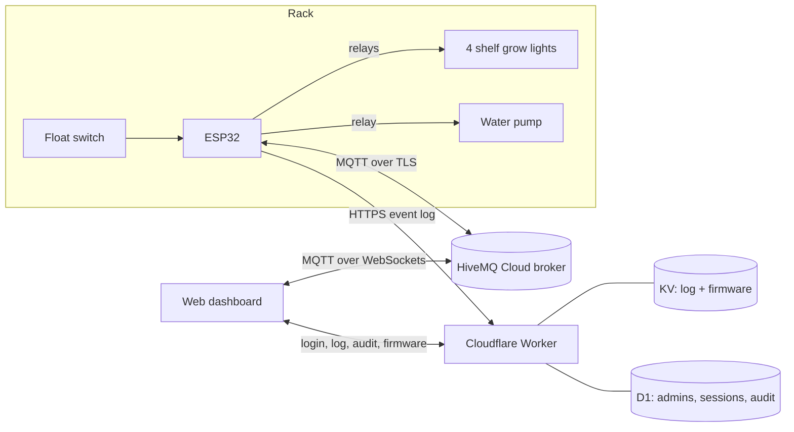

# Smart Hydroponics Controller

**ESP32 firmware, a cloud backend and a live web dashboard for a 4-shelf hydroponic grow rack at Lamba.**


This project upgrades an existing hydroponic rack. The frame, shelves, reservoir and plumbing were
already built. I upgraded the **lighting, electronics and software**, and designed and built the
**website and cloud backend** from scratch, so the rack runs on its own and anyone can watch it live
from a browser.

| | Before | After (this project) |
| --- | --- | --- |
| Lighting | _[describe the original lighting]_ | Grow light on each shelf with its own relay and its own on/off schedule |
| Electronics | _[describe the original setup]_ | ESP32 with a 5-channel relay board and a float switch in the reservoir |
| Software | _[describe the original software, or "none"]_ | Firmware that runs on real time, survives power cuts and updates over Wi-Fi |
| Monitoring | _[e.g. "none, had to check in person"]_ | Live web dashboard: a public read-only view plus an admin login |

---

## Features

**On the device (ESP32)**
- **Light schedule on real time.** The clock syncs from internet time servers (NTP). If a network
  blocks NTP, it falls back to the time in an HTTPS reply. Lights stay on for 8–16 h a day, starting
  at a set time.
- **Survives power cuts.** Each schedule saves its start time ("anchor") in flash. After a reboot the
  ESP32 works out where each cycle should be, so no time is skipped or shifted.
- **Pump cycle with dry-run protection.** The pump cycles on and off (5–60 min each). It never runs
  when the tank is empty. The float switch reading is debounced: the tank only counts as empty or full
  when 80% of readings over 10 s agree, and then stays put for at least 30 s.
- **Manual demo mode.** Shelves and pump can be switched by hand. After 10 minutes the system goes
  back to automatic. The schedules keep running in the background the whole time.
- **Master switch for each shelf.** A shelf that isn't in use stays off and saves power.
- **Pump maintenance switch.** Holds the pump on or off, for example to drain the tank.
- **Wireless firmware updates** two ways: from the Arduino IDE on the local network, or from the
  dashboard using a private download link that expires after 15 minutes.
- **Self-healing connection.** Wi-Fi and MQTT reconnect step by step without blocking the schedules.
  The device never reboots just because it's offline, since a reboot would lose the clock.

**On the web**
- **Live dashboard** over MQTT on WebSockets: shelf lights, pump flow animation, tank level,
  schedule progress rings, and a planting-date counter for each shelf.
- **Public preview mode.** Anyone with the link can watch, using a subscribe-only MQTT login. The
  broker refuses any command sent with it.
- **Admin mode.** Admins log in to get full control. The full-control MQTT login comes from the
  server only after login and is never in the page source.
- **Audit trail.** Records who logged in, from what kind of device, who is online now, and who changed what.
- **Event log** from the device ("Tank empty", "Back online after 3m 05s: Wi-Fi dropped…"), stored in the cloud.
- **Firmware management.** Upload the compiled `.bin`, keep the `.ino` as a backup, and install it
  on the device from the dashboard.

## Dashboard


## How it works



- **ESP32 to broker:** the device publishes its state (retained) and listens for commands on `hydroponics/...` topics.
- **Dashboard to broker:** preview users subscribe only. Admins publish commands.
- **Worker:** a small serverless backend for the event log, admin accounts and firmware storage.

## Tech stack

| Part | Built with |
| --- | --- |
| Firmware | C++ (Arduino framework on ESP32), PubSubClient, FreeRTOS task for log uploads, Preferences (flash storage), ArduinoOTA + HTTPUpdate |
| Messaging | MQTT (HiveMQ Cloud), TLS on port 8883, WebSockets on port 8884 |
| Backend | Cloudflare Workers (JavaScript), KV, D1 (SQLite) |
| Frontend | A single HTML/CSS/JS page with MQTT.js, hosted as a static site |

## Hardware

| Part | Details |
| --- | --- |
| Controller | ESP32-WROOM-DA (or ESP32 Dev Module) |
| Relays | 5 channels: 4 shelf lights (active-LOW) + pump (active-HIGH) |
| Water level | Float switch between GPIO 27 and GND (internal pull-up), closed = tank empty |
| Grow lights | _[model / type / wattage]_ |
| Pump | _[model]_ |
| Power | _[power supply details]_ |

| Channel | GPIO |
| --- | --- |
| Shelf 1 (bottom) | 21 |
| Shelf 2 | 19 |
| Shelf 3 | 22 |
| Shelf 4 (top) | 18 |
| Pump | 17 |
| Float switch | 27 |


## Repository layout

```
firmware/hydro_vOTA/
  hydro_vOTA.ino          ESP32 firmware
  secrets.example.h       copy to secrets.h and fill in (secrets.h is git-ignored)
worker/
  hydro-log-worker.js     Cloudflare Worker backend
website/
  index.html              dashboard (preview + admin)
  admin-setup.html        create / reset admin accounts
docs/
  SETUP.md                full setup guide
```

## Security design

- Real credentials stay out of the code: the firmware reads them from a git-ignored `secrets.h`,
  and the Worker reads them from Cloudflare secrets.
- There are three MQTT logins with different permissions: device, read-only viewer, and admin.
  The page only ever contains the read-only one.
- Admin passwords are hashed with PBKDF2-SHA256 (100k iterations) and a random salt, and compared
  in constant time.
- Wrong logins are locked out (5 per account / 10 per IP in 15 min). Sessions last 7 days and
  reset when a password is reset.
- The firmware download link uses a random token and expires after 15 minutes.

## Setup

See **[docs/SETUP.md](docs/SETUP.md)** to deploy your own copy (broker, Worker, website, firmware).

## Roadmap

- [ ] Humidity control: DHT11 sensor + a USB mini humidifier, switched on and off by the ESP32
- [ ] Humidity readings and history on the dashboard
- [ ] Verify TLS certificates on the ESP32 (it currently uses `setInsecure()`)
- [ ] Limit dashboard firmware updates to the project's own Worker URL (`OTA_URL_PREFIX`)

## Credits

Built at **Lamba**. Original rack built by _[name / team]_. Lighting, electronics, firmware,
backend and dashboard upgrade by _[your name]_.
