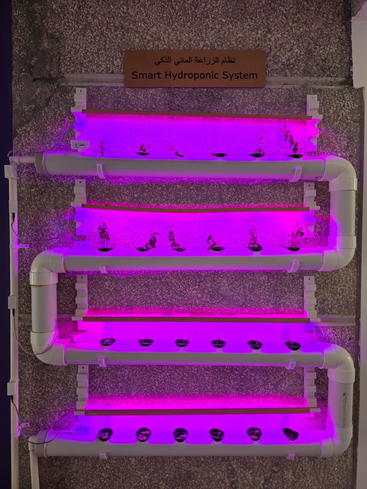
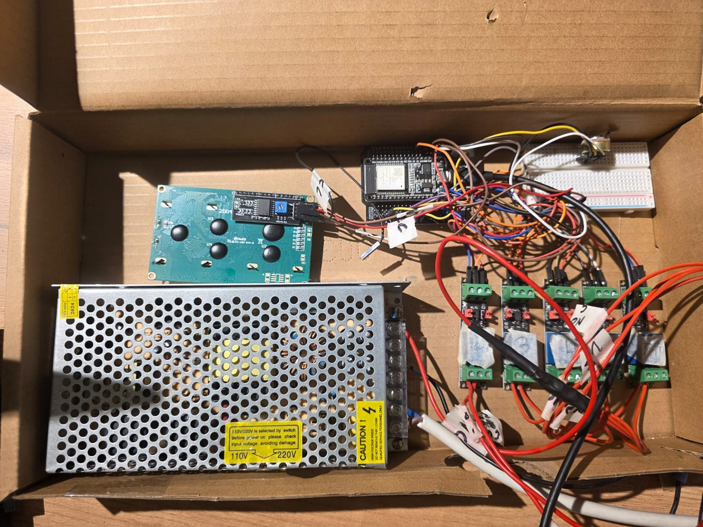
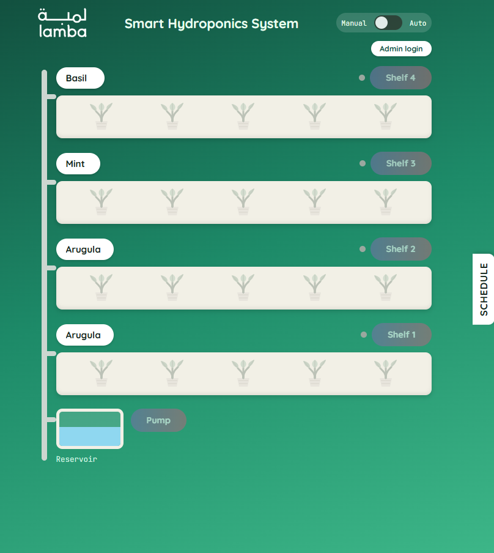
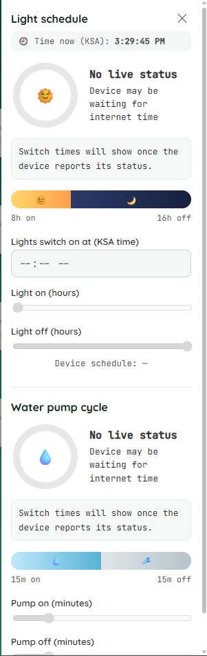
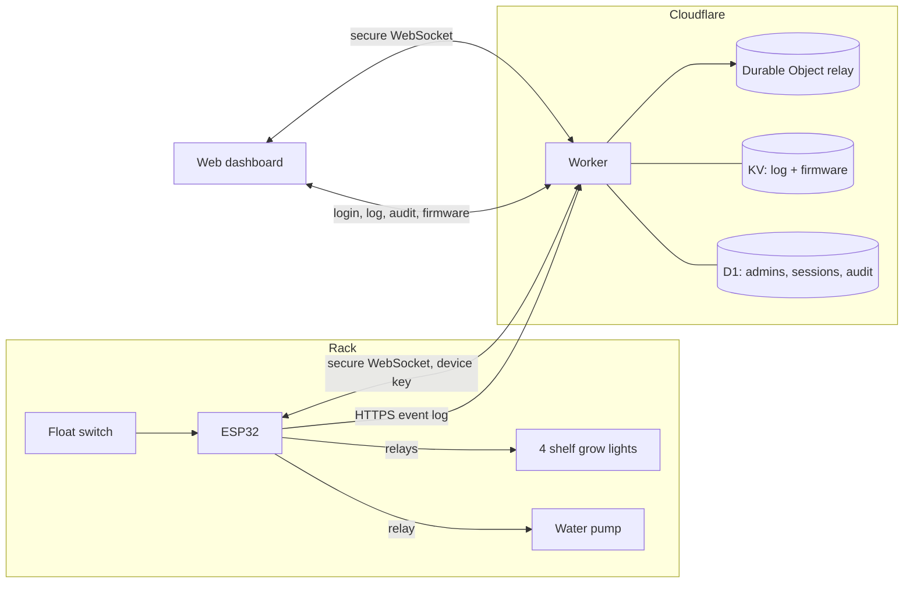
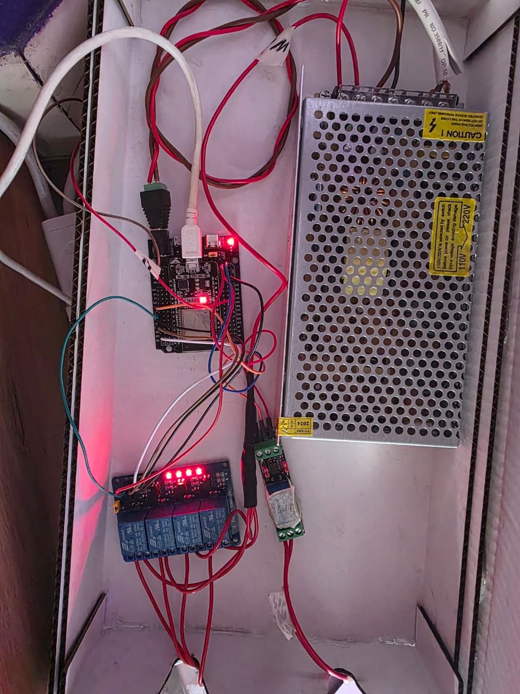
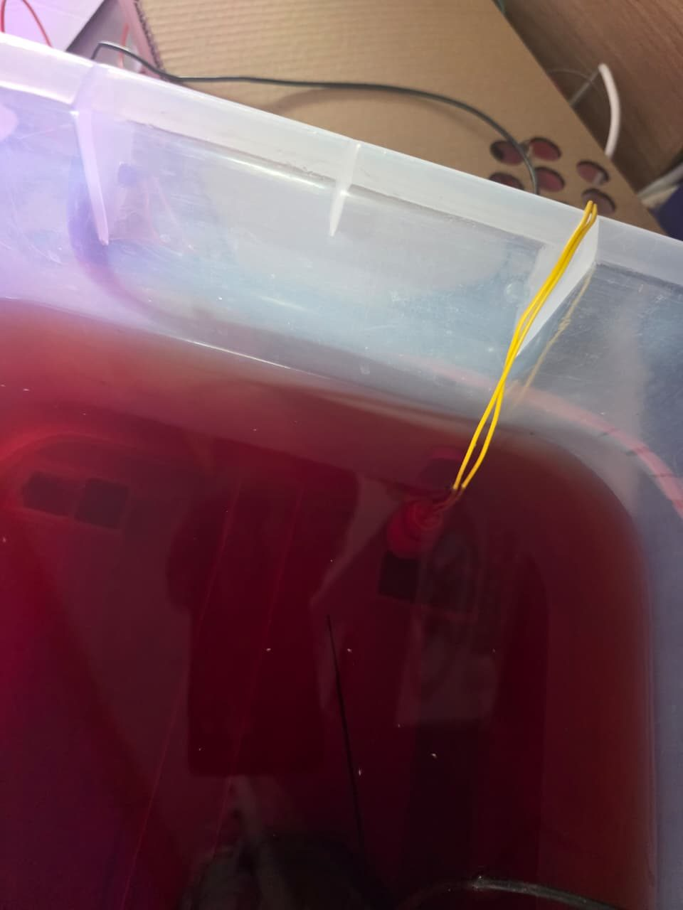
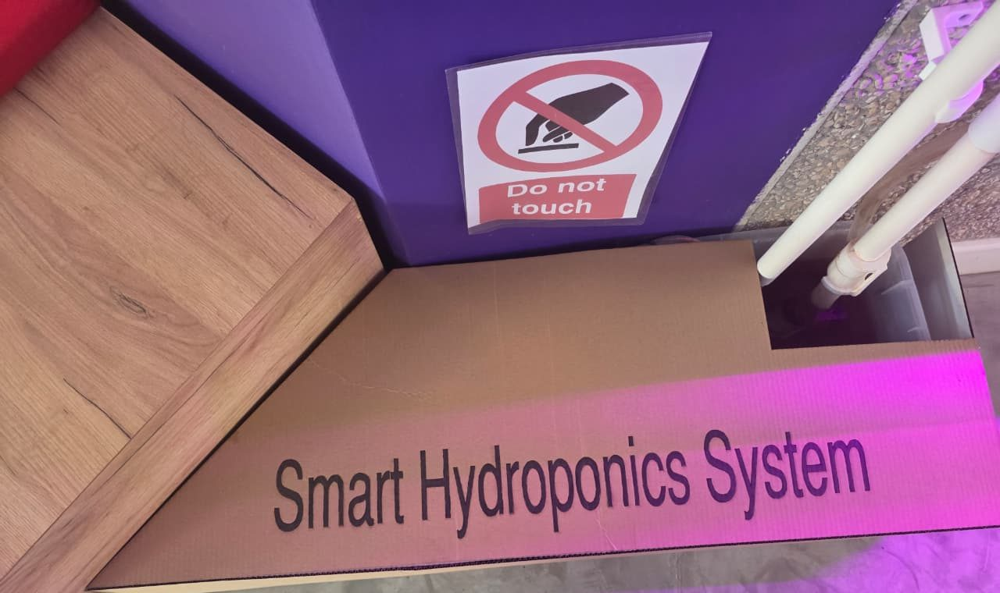
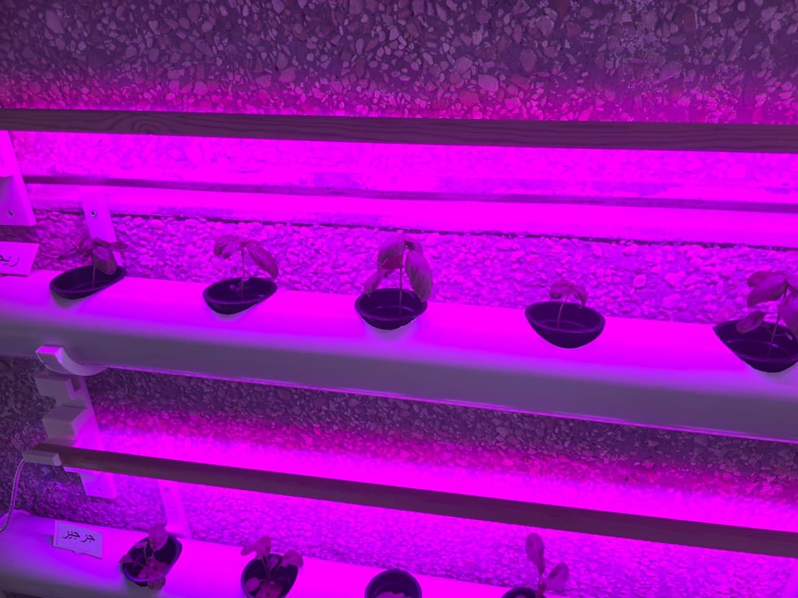

# Smart Hydroponics Controller

**ESP32 firmware, a cloud backend and a live web dashboard for a 4-shelf hydroponic grow rack at Lamba.**

<p align="center"></p>

This project upgrades an existing hydroponic rack at Lamba, originally built by Mohamed Asim Khidir.
The frame, shelves, plumbing and LED rails were already in place, with a basic controller that was
used mainly for demonstrations. I **repaired the lighting**, **rebuilt the electronics**, **wrote new
firmware**, and designed and built the **website and cloud backend** from scratch. The rack now runs
on its own, and anyone can watch it live from a browser.

| | Before | After (this project) |
| --- | --- | --- |
| Lighting | 2 of the 8 LED rails weren't working properly because of bad solder joints | All rails repaired and re-soldered; each shelf has its own relay and schedule |
| Electronics | ESP32 on an expansion board driving 3.3 V relay modules, with a 20×4 LCD | ESP32 with a 5 V 4-channel relay board powered from the main supply, a separate relay for the pump, and a float switch |
| Software | Simple relay on/off code linked to the Blynk IoT app, used only to demo the lights and pump; schedule set with an external rotary switch | Firmware that runs on real time, survives power cuts and updates over Wi-Fi |
| Monitoring | Check in person whether the lights were on, and read the schedule on the LCD | Live web dashboard: a public read-only view plus an admin login |
| Water level | No protection or monitoring; the pump could run dry | Float switch with debounced readings; the pump never runs on an empty tank |

<details>
<summary>The original controller, before the upgrade</summary>



</details>

---

## Features

**On the device (ESP32)**
- **Light schedule on real time.** The clock syncs from internet time servers (NTP). If a network
  blocks NTP, it falls back to the time in an HTTPS reply. Lights stay on for 8–16 h a day, starting
  at a set time.
- **Survives power cuts.** Each schedule saves its start time ("anchor") in flash. After a reboot the
  ESP32 works out where each cycle should be, so no time is skipped or shifted.
- **Pump cycle with dry-run protection.** The pump cycles on and off (5–60 min each). It never runs
  when the tank is empty. The float switch reading is debounced: the tank only counts as empty or full
  when 80% of readings over 10 s agree, and then stays put for at least 30 s.
- **Manual demo mode.** Shelves and pump can be switched by hand. After 10 minutes the system goes
  back to automatic. The schedules keep running in the background the whole time.
- **Master switch for each shelf.** A shelf that isn't in use stays off and saves power.
- **Pump maintenance switch.** Holds the pump on or off, for example to drain the tank.
- **Wireless firmware updates** two ways: from the Arduino IDE on the local network, or from the
  dashboard using a private download link that expires after 15 minutes.
- **Self-healing connection.** Wi-Fi and the live relay link reconnect step by step without blocking the schedules.
  The device never reboots just because it's offline, since a reboot would lose the clock.

**On the web**
- **Live dashboard** over WebSockets: shelf lights, pump flow animation, tank level,
  schedule progress rings, and a planting-date counter for each shelf.
- **Public preview mode.** Anyone with the link can watch. Viewers connect read-only, and the
  relay ignores any command they send. The page holds no passwords at all.
- **Admin mode.** Admins log in to get full control. Their login token unlocks commands on the
  live connection, and every change is recorded under their name.
- **Audit trail.** Records who logged in, from what kind of device, who is online now, and who changed what.
- **Event log** from the device ("Tank empty", "Back online after 3m 05s: Wi-Fi dropped…"), stored in the cloud.
- **Firmware management.** Upload the compiled `.bin`, keep the `.ino` as a backup, and install it
  on the device from the dashboard.

## Dashboard




## How it works



- **ESP32 to relay:** the device keeps one secure WebSocket open to the Worker. It publishes its
  state on `hydroponics/...` topics and receives commands on the same connection.
- **Durable Object relay:** a single Cloudflare Durable Object acts as a small broker. It remembers
  the latest ("retained") value of each state topic, forwards messages to whoever subscribed,
  checks who is allowed to send commands, and marks the device offline when its connection drops.
- **Dashboard to relay:** preview users only receive. Admins send commands after the relay checks
  their login token against the D1 sessions table.
- **Worker:** the same serverless backend also handles the event log, admin accounts and firmware storage.

### Why a Durable Object instead of an MQTT broker

The first version used HiveMQ Cloud as its MQTT broker. Moving the messaging into a Cloudflare
Durable Object puts the whole system on one platform, behind one set of secrets:

- **No broker passwords in the page.** HiveMQ needed a read-only login inside the public HTML.
  Now viewers need no credentials, and admins use the login they already have.
- **One place for access rules.** The relay knows the difference between the device, a viewer and
  an admin, so permissions live in code next to the rest of the backend.
- **Fewer moving parts.** One service to deploy and monitor instead of two.

The topic names and message meanings stayed the same, so the firmware's schedule, safety and OTA
logic didn't change. Only the transport did.

## Tech stack

| Part | Built with |
| --- | --- |
| Firmware | C++ (Arduino framework on ESP32), WebSockets + ArduinoJson, FreeRTOS task for log uploads, Preferences (flash storage), ArduinoOTA + HTTPUpdate |
| Messaging | Cloudflare Durable Object relay (WebSocket Hibernation API), MQTT-style topics as JSON frames |
| Backend | Cloudflare Workers (JavaScript), KV, D1 (SQLite) |
| Frontend | A single HTML/CSS/JS page with no libraries, hosted as a static site |

## Hardware

| Part | Details |
| --- | --- |
| Rack | 4 shelves, about 1.5 m tall, growing basil, mint and arugula |
| Controller | ESP32-WROOM-DA (or ESP32 Dev Module) |
| Relays | 5 V 4-channel relay module for the shelf lights (active-LOW), plus a separate 3.3 V relay module for the pump (active-HIGH) |
| Water level | Float switch between GPIO 27 and GND (internal pull-up), closed = tank empty |
| Grow lights | 12 V LED rails, about 60 cm, 2 per shelf (8 in total) |
| Pump | 12 V submersible pump |
| Power | 12 V power supply |

| Channel | GPIO |
| --- | --- |
| Shelf 1 (bottom) | 21 |
| Shelf 2 | 19 |
| Shelf 3 | 22 |
| Shelf 4 (top) | 18 |
| Pump | 17 |
| Float switch | 27 |

<p align="center">
  
  
</p>
<p align="center"></p>
<p align="center"></p>

## Repository layout

```
firmware/hydro_vOTA/
  hydro_vOTA.ino          ESP32 firmware
  secrets.example.h       copy to secrets.h and fill in (secrets.h is git-ignored)
worker/
  hydro-log-worker.js     Cloudflare Worker backend + HydroRelay Durable Object
  wrangler.toml           deploy config (bindings, Durable Object migration; no secrets)
website/
  index.html              dashboard (preview + admin)
  admin-setup.html        create / reset admin accounts
docs/
  SETUP.md                full setup guide
```

## Security design

- Real credentials stay out of the code: the firmware reads them from a git-ignored `secrets.h`,
  and the Worker reads them from Cloudflare secrets.
- The relay has three roles: the device (proven with a secret key header), read-only viewers,
  and admins (proven with a login token). The role is decided on the server, never by the client.
  Admins can only send commands (`.../set` topics), so they can't fake the device's state.
- The public page contains no passwords or keys.
- Admin passwords are hashed with PBKDF2-SHA256 (100k iterations) and a random salt, and compared
  in constant time.
- Wrong logins are locked out (5 per account / 10 per IP in 15 min). Sessions last 7 days and
  reset when a password is reset.
- The firmware download link uses a random token and expires after 15 minutes.

## Setup

See **[docs/SETUP.md](docs/SETUP.md)** to deploy your own copy (Worker + Durable Object, website, firmware).

## Roadmap

- [ ] Humidity control: DHT11 sensor + a USB mini humidifier, switched on and off by the ESP32
- [ ] Humidity readings and history on the dashboard
- [ ] Verify TLS certificates on the ESP32 (it currently uses `setInsecure()`)
- [ ] Limit dashboard firmware updates to the project's own Worker URL (`OTA_URL_PREFIX`)

## Credits

Built at **Lamba**.

- **Original rack:** Mohamed Asim Khidir
- **Upgrade** (lighting repair, electronics, firmware, backend and dashboard): Raed Mohannad Elnour
- **Thanks to** Coach Baraa Aljelani
